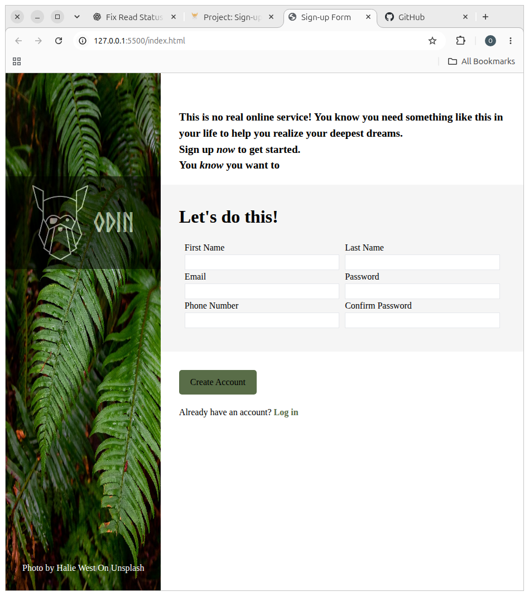

# Sign-up Form
This project is build as part of **The Odin Project** Intermediate HTML and CSS
<https://www.theodinproject.com/lessons/node-path-intermediate-html-and-css-sign-up-form>

## About Project
This project is designing a simple display how of a login form is built where users will use to sign into websites, systems etc.

This project focuses on the use of:
- Custom fonts
- flex
- Opacity
- form element

## Live Demo
<https://osmanamin0448.github.io/sign-up-form/>

## Screenshot


## How To Get Project
```bash
git clone git@github.com:osmanamin0448/sign-up-form.git
```
